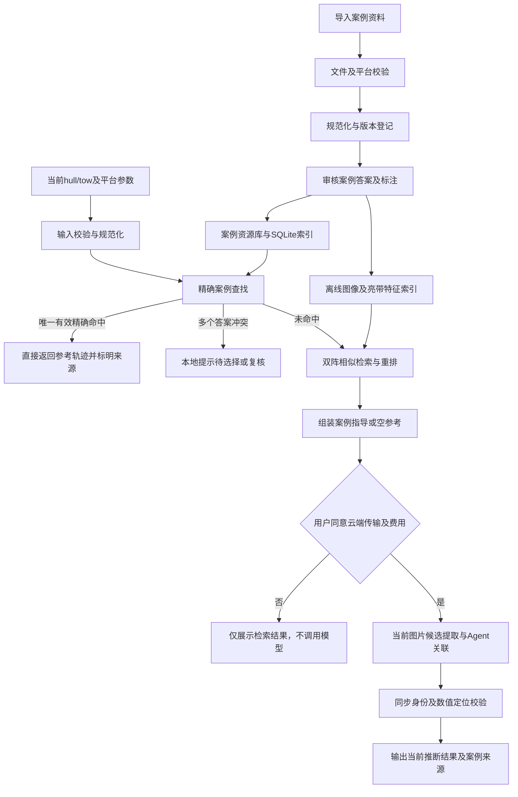

# 声呐案例知识库技术方案

- 文档版本：V1.0（整合版）
- 编制日期：2026-11-18
- 适用项目：`C:\Users\LENOVO\Desktop\btr_gens\qwen_image_client`
- 状态：技术设计，待实施。本文件不是功能上线或准确率提升的证明。
- 本次范围：整合设计；不改仿真工具、识别参数和运行代码，不下载模型，不调用付费接口。

## 1. 建设目标与边界

建立以“同一样本的两张声呐图＋平台参数＋参考轨迹”为基本单元的案例知识库，支持两种业务：

1. **已知样本复用**：输入与有效案例完全一致时，直接提交已保存的参考轨迹图，不再调用大模型。
2. **新样本参考推断**：输入不是已有样本，但存在相关案例时，给智能体提供视觉和结构化指导，仍基于当前观测生成关联及空间候选。

精确复用本质是经过校验的答案查找，不属于新样本识别。相似检索只提供指导，不授权照搬坐标、目标数量或参考图。知识库不替代当前候选提取、双阵同步关联、几何定位和质量校验，也不能单独解决折叠方位的镜像歧义。

首期支持单平台、明确标识hull/tow的一对图片。多平台联合检索、模型微调和自动学习不进入首期范围。缺少完整案例时可保存草稿，但不得自动复用。

## 2. 现状与接入依据

经代码检查，已有FastAPI、LangGraph、Pillow、NumPy、SciPy及模型网关；已有规则检索只是内置SQLite规则，不是案例检索。实际案例导入、视觉索引和精确轨迹复用尚未实现。

| 现有模块 | 已有职责 | 拟接入变化 |
|---|---|---|
| `Knowledge`规则服务 | 内置审核规则检索 | 保留，与案例库分开管理 |
| `RecognitionWorkflow` | 包围模型网关的识别与后处理 | 模型调用前增加案例分流 |
| `EvidenceState`／预处理图 | 当前图片候选、亮带、关联上下文 | 增加检索上下文，不替换当前观测 |
| `SonarAssociationAgent` | 当前候选选择、模型调用 | 加入明确标记的案例参考 |
| `ModelGateway` | 同步和SSE外部模型边界 | 保持精确路径零调用、普通任务最多一次调用 |
| `ResultRepository`／响应schema | 现有推断结果和历史 | 增加不要求数值轨迹的“参考图复用”结果类型 |
| 前端 | 上传、节点执行、结果展示 | 增加案例管理、命中详情、来源和费用边界 |

关键现有代码：

- [规则检索](C:/Users/LENOVO/Desktop/btr_gens/qwen_image_client/backend/app/services/knowledge.py)
- [识别入口](C:/Users/LENOVO/Desktop/btr_gens/qwen_image_client/backend/app/api/routers/recognition.py)
- [证据工作流](C:/Users/LENOVO/Desktop/btr_gens/qwen_image_client/backend/app/workflows/evidence_graph.py)
- [声呐Agent](C:/Users/LENOVO/Desktop/btr_gens/qwen_image_client/backend/app/agents/sonar_agent.py)
- [结果仓储](C:/Users/LENOVO/Desktop/btr_gens/qwen_image_client/backend/app/repositories/result_repository.py)

特别注意：现有流式入口提前校验云端同意和API Key。实施时必须调整调用顺序，不能仅在模型调用之后增加一个“检索节点”，否则无法实现无Key、无云端同意的免费精确复用。

## 3. 总体架构

采用“**案例仓储＋双阵混合检索＋受约束案例指导＋LangGraph条件分流**”，不是将所有资料切成文字后做普通问答RAG。



三类数据各自独立：

- **规则库**：通用约束、解释和项目约定。
- **案例库**：用户明确导入、可审核和溯源的参考样本及答案。
- **结果库**：每次运行的输入摘要、命中记录、模型输出和诊断结果。

本系统失败或未经确认的推断结果不自动进入正确案例库，防止错误自我强化。

## 4. 技术选型与部署

| 层次 | 方案 | 采用原因与限制 |
|---|---|---|
| HTTP与上传 | 沿用FastAPI | 不新增独立Web框架 |
| 编排与事件 | 沿用LangGraph与现有SSE | 条件分流和真实节点展示，不靠模型自由决定是否复用 |
| 案例元数据 | SQLite | 首期本地持久化、事务和版本管理 |
| 案例资源 | 本地文件系统 | 原图、参考图、数值轨迹与索引分开 |
| 精确索引 | SHA-256＋规范化平台JSON | 不依赖模型或向量相似度 |
| 图像编码 | DINOv2 ViT-S候选编码器 | 本地提取特征；声呐适用性待隔离评测，不预设有效 |
| 结构特征 | NumPy／SciPy＋现有亮带处理 | 补充时间分布、方位变化和交叉结构，避免只检索配色 |
| 相似索引 | 首期NumPy余弦检索 | 少引依赖，先验证检索价值，再实测规模和延迟 |
| 扩展索引 | 按需接FAISS | 索引加速，不改变案例审核与精确命中规则 |
| 关联与定位 | 现有视觉模型与数值程序 | 案例指导不直接生成可信坐标 |

DINOv2模型卡提供图像全局和patch特征的说明；这支持选为候选编码器，不证明声呐精度。模型权重、Python/PyTorch兼容性、CPU/GPU资源及许可在第二阶段验证；第一阶段精确复用不依赖它。[官方模型卡](https://github.com/facebookresearch/dinov2/blob/main/MODEL_CARD.md)

FAISS用于稠密向量相似搜索；没有实测规模瓶颈前，不先部署向量数据库或额外服务。[官方文档](https://faiss.ai/index.html)

首期采用本机单服务部署。若将来开放局域网或多人访问，必须先补鉴权、案例写权限和资源访问权限，不能直接暴露当前本地管理接口。

## 5. 案例资料与标注标准

### 5.1 必需与可选内容

| 内容 | 要求 | 作用 |
|---|---|---|
| hull图 | 必需，明确平台和阵列角色 | 当前/参考双阵输入之一 |
| tow图 | 必需，属于同一样本及平台 | 当前/参考双阵输入之一 |
| platform.json | 必需，受支持的schema | 位置、航向、速度、双阵偏移、时间及坐标约定 |
| 参考轨迹图 | 必需，确认来自该样本 | 精确复用和相似视觉指导 |
| 数值轨迹 | 可选，强烈建议 | 精确坐标交付、结构化指导及误差评测 |
| 目标/交叉标注 | 可选，需说明来源与审核状态 | 目标身份延续、交叉前后对应、出现/消失时刻 |
| 案例说明 | 可选，长度受限 | 记录遮挡、弱信号、歧义和适用条件 |

数值轨迹统一为明确坐标系、目标ID和递增时间的点列，例如 `coordinate_system=lon_lat`，点字段为 `t/x/y`，经纬度顺序及时间单位固定。只有PNG时，`numeric_tracks_available=false`，不得由图片虚构坐标或提供假tracks.json。

工具的meta/truth可在用户明确选定后由离线导入器转成案例标签；不是将任意meta或truth混入当前输入，也不自动扫描全部目录。JS资料若后续需要支持，只允许受限数据解析，不执行代码。

### 5.2 案例生命周期

`draft → validating → pending_review → approved → inactive`

- 存在文件缺失、角色不明、答案来源不明时保持草稿或失败。
- 仅approved且active的完整版本参与自动复用或指导。
- 审核至少确认图片配对、平台对应、参考图来源与可选标注；“已审核来源”不等于完成真实世界精度验证。
- 内容修改创建新版本，不覆盖被运行记录引用的旧版本。
- 反馈只能创建待审核修订，不自动学习或覆盖案例。

### 5.3 首期资源边界

建议沿用当前系统图片数/体积约束，导入接口单独制定并测试：四张以内图片（两阵及参考，预留一张辅助图），单图不超过10MiB、图片合计不超过20MiB、单图不超过1600万像素；平台文件不超过100KB。可选数值轨迹和标注另设大小、点数和文本长度限制。

以上是拟实施限制，不代表现有导入接口已经存在。受支持图片格式、解码检查、上传总量和请求体上限要统一，不能只信文件扩展名。

## 6. 持久化与数据模型

建议案例存储根为：`C:\Users\LENOVO\Desktop\btr_gens\qwen_image_client\knowledge_base`，运行日志仍归原日志体系；该目录默认不提交Git。

| 表 | 主要字段 |
|---|---|
| cases | case_id、title、active_version、created_at、updated_at |
| case_versions | case_id、version、source、review_status、active、match_key、platform_json、coordinate_system、numeric_tracks_available |
| case_assets | case_id、version、role、服务端固定文件名、file_sha256、pixel_sha256、bytes |
| case_features | case_id、version、encoder_version、preprocess_version、hull_vector、tow_vector、structure_descriptor、checksum、index_status |
| retrieval_runs | request_id、input_digest、match_type、case_id/version、scores、decision_reason、actual_context_assets、result_source、new_model_calls |

约束：`(case_id, version)`与资源role唯一；允许match_key对应多个案例版本，以便发现答案冲突，而不是用唯一约束隐藏冲突。完全相同的有效答案可折叠为一个内容版本及多个来源记录。

写入顺序：暂存并校验资源 → 生成不可变版本目录 → 数据库事务登记 → 审核/索引就绪后发布。失败版本不参与查询，孤立暂存文件由受控维护任务处理。向量索引不是数据真源，索引缺失可重建；数据库、图片和索引版本不一致时降级或拒绝复用。

## 7. 检索算法

### 7.1 第一层：精确案例查找

规范化必须在导入和查询时使用同一版本：

1. 解码图片，固定像素方向/色彩模式；保留原文件哈希用于审计。
2. 按hull/tow角色计算包含尺寸、模式和完整像素内容的哈希；不得为精确命中做缩放、裁剪或感知近似。
3. 校验并规范化平台参数，统一单位、数字表示和JSON键顺序。平台位置、航向、航速、阵列偏移、时间范围/方向、方位范围/折叠约定及有效投影约定均纳入；不静默丢弃影响物理含义的字段，不做近似四舍五入。
4. 计算：

```text
match_key = SHA256(canonical_json({
  normalization_version,
  hull_pixel_sha256,
  tow_pixel_sha256,
  normalized_platform
}))
```

文件改名、上传顺序变化、JSON排版变化不影响语义相同输入的命中；任一图像实际像素或关键平台值改变则不得精确命中。JPEG重编码引起像素变化时转为相似查询，不声称精确一致。

只在唯一有效、已审核且资源完整的答案存在时自动复用。相同键有冲突答案时返回`conflict`，不按入库先后任选，不自动转付费推断。审核状态和资源哈希在实际交付前再次检查。

### 7.2 第二层：双阵相似检索

相似查询仅使用当前声呐图及平台数据，不能使用当前未知参考轨迹。案例参考轨迹是命中后的资料，不是当前查询向量的一部分。

- 视觉特征：分别提取hull/tow的归一化全局特征；需要时增加分时段patch特征，避免全图缩小抹掉窄亮带。
- 结构特征：可检索持续亮带分布、时间覆盖、方位变化、交叉区域等；提取不足时明确标记缺失，不能用“目标数线索”当作已知数量。
- 参数约束：不兼容的轴/单位/阵列约定先排除；时间范围、基线与运动参数差异作为明确的适用条件或重排因素。地理位置不同不意味着形态案例绝无参考价值，但绝不允许迁移坐标答案。
- 召回及重排：两阵分别召回并联合重排，不能只看单图或仅用平均分掩盖另一阵不匹配。

初始工程配置可为Top20候选、重排Top3、实际送模型最多Top1；这些不是已验证最优值。综合视觉、结构和参数的权重、单阵最低阈值、Top1/Top2间隔，均由验证集标定。检索分数不是目标置信度，严禁用“相似度超过某数值”替代精确复用条件。

编码器、预处理或特征schema变更必须重建相应索引，不能混用不同版本向量。模型/索引不可用时，精确分支仍工作，相似分支返回不可用说明，不暗中调用外部Embedding API。

## 8. 案例如何指导智能体

相似命中构造独立`case_context`，内容包括case_id/version、来源、双阵图、参考轨迹图、审核标注、相似分项及适用差异；当前图片及当前候选表保持独立。

送给模型的资料顺序明确区分“当前观测”和“历史参考”：

- 当前两图、标定信息、当前candidate_pairs候选编号。
- 一个案例的两阵图与参考轨迹图，最多三张案例图，加当前两张共五张；原图不适合直接发送时使用有版本的参考派生图，不改当前测量图。
- 案例说明及交叉前后关联依据；不能把参考数量变成当前硬性目标数。
- 明确约束：参考轨迹不是当前答案，案例候选编号不允许进入当前candidate_pairs；不能复制坐标、伪造点位或绕过原校验。

附图前仍检查图片数、体积及实际模型请求预算；超限时仅提供受限结构说明或不提供参考，记录实际发送内容。当前任务没有用户云端授权时，不发送当前图片或案例资料。关联调用仍最多一次，不增加自动付费纠错循环。

这里使用的是视觉案例上下文指导，而非模型微调。它可能减少错误判断，但是否改善当前交叉问题，必须用隔离样本验证。

## 9. LangGraph工作流与状态

### 9.1 节点与路由

| 节点 | 职责 | 云端模型调用 |
|---|---|---|
| input_normalization | 文件、平台校验与规范化 | 无 |
| exact_case_lookup | 精确键、审核状态、冲突检查 | 无 |
| reference_reuse | 输出已存参考图和来源 | 无 |
| similar_case_retrieval | 双阵特征检索与重排 | 无，使用本地特征模型 |
| case_context_assembly | 组装预算内的参考资料 | 无 |
| 原候选与规则节点 | 处理当前观测 | 无 |
| 原模型关联节点 | 当前目标清单与双阵关联 | 最多一次 |
| 原后处理节点 | 同步、身份、定位、连续性、重投影 | 无 |

精确命中直接结束；冲突待复核；未命中且无云端授权只展示本地检索；获得授权后才校验模型配置并继续推断。空库、低相关性或无合适案例时，case_context为空，运行原流程，不强行检索一个参考。

采用条件边进行确定性分流，不由LLM决定是否“命中”或是否绕过收费检查。[LangGraph条件边文档](https://reference.langchain.com/python/langgraph/graph/state/StateGraph/add_conditional_edges)

### 9.2 新增状态字段

`query_fingerprint`、`retrieval_mode`（exact/similar/none/conflict）、`retrieved_cases`、`case_context`、`result_source`、`new_model_calls`、`normalization_version`、`knowledge_snapshot_version`。

不把API Key、任意磁盘路径或未限制大小的案例原文放入Graph状态。当前观测状态与参考案例状态分开，复用现有节点事件与SSE传输。

## 10. 后端接口与结果契约

### 10.1 拟新增接口

| 方法与路径 | 功能 |
|---|---|
| POST /api/knowledge/cases | multipart导入一组资料，创建待审核版本 |
| GET /api/knowledge/cases | 分页列举、按审核/来源筛选 |
| GET /api/knowledge/cases/{id} | 查看版本、来源和资源摘要 |
| PATCH /api/knowledge/cases/{id} | 审核、激活或停用；资料变更另建版本 |
| GET /api/knowledge/cases/{id}/versions/{version}/assets/{role} | 按固定role和权限返回资源 |
| POST /api/knowledge/resolve | 上传当前两图及平台，执行免费本地检索 |

`resolve`的业务状态为exact、similar、none、conflict或unavailable。输入错误返回明确4xx。它不触发模型调用，也不要求API Key；真正推断仍使用现有识别接口，服务端不能只相信前端传来的“命中”声明。

若检索与推断分成两次请求，可返回服务端持有的短期query_id；推断时绑定输入摘要和案例版本并再次检查状态，防止换图、换参数和停用后的过期引用。云端授权只对当前请求及实际案例上下文有效。

### 10.2 精确复用响应示例

```json
{
  "ok": true,
  "retrieval_mode": "exact",
  "result_source": "knowledge_exact_match",
  "case_id": "case_000001",
  "case_version": 1,
  "trajectory_status": "reference_reuse",
  "trajectory_image": "/api/knowledge/cases/case_000001/versions/1/assets/reference",
  "numeric_tracks_available": false,
  "new_model_calls": 0,
  "warnings": ["已有案例参考图复用，不是本次独立反演；未提供数值轨迹。"]
}
```

普通推断来源为`model_inference`；使用案例指导则为`model_inference_with_case_guidance`。相似案例的参考图URL与当前结果图URL必须分开，不能用参考URL填充当前estimated图字段。

历史结果需记录来源与不可变版本/资源快照。仅有PNG的复用结果不能被现有“必须存在tracks.json”的历史读取条件误判为失败，必须扩展结果schema和历史读取逻辑；不创建假轨迹JSON凑字段。

## 11. 前端交互与可观测性

新增案例管理区：按角色选择资料、查看缩略图、填写来源及标注、审核/停用、查看版本。批量导入后续通过显式选定目录/资料包实现，不自动扫描电脑或历史outputs。

识别前先执行免费检索并展示：命中类型、案例编号/版本、参考图、参数差异和分项相似度。

- 精确命中：标为“知识库参考图复用”，显示本次模型调用为零，可直接提交/下载。
- 相似命中：同时展示“参考案例”和“当前输入”，在获得云端授权后进行案例指导推断。
- 未命中：明确提示“未找到合适案例”，不显示假命中。
- 冲突：列出冲突来源，要求选择或审核，不自动付费解决。

实际执行的检索节点显示耗时和依据；精确复用时模型/定位节点显示“已跳过：已知案例复用”，不得显示假完成、假Token或假推断置信度。提供关闭案例指导的对照选项。

## 12. 安全、来源与质量控制

- 文件由服务端生成存储名；禁止路径穿越、符号链接越界及任意文件读取。资源访问使用case_id/version/role白名单。
- 解析平台schema、图片解码/像素数、数值有限性、时间递增和点数上限，拒绝可执行内容。
- 笔记、截图文字和案例说明是非可信资料，不是系统指令；不执行上传代码。
- 仅用户明确导入并确认来源的答案可审批入库，未经确认的模型诊断图不作为正确标签。
- 审计检索决定、案例版本和模型调用次数，不记录密钥；不默认复制完整提示词或敏感原图到普通日志。
- 参数不符或资源不完整时宁可拒绝复用，不以“相似”掩盖校验失败。存储不可写、索引损坏时不假装命中。
- 备份需绑定数据库、案例不可变资源、特征版本和索引快照；在临时目录恢复校验后再替换在线快照。

## 13. 测试与验收标准

### 13.1 功能与零费用路径

| 测试 | 预期 |
|---|---|
| 两图及平台完整精确命中 | 返回正确案例及参考图，网关调用数为0 |
| 缺API Key、未同意云端但精确命中 | 仍可本地复用 |
| 调换上传顺序、改文件名、改JSON键顺序 | 角色与语义不变时仍命中 |
| 改任一像素、航向、位置、基线、时间范围或轴约定 | 不走精确复用 |
| 相同键多个冲突答案、未审核或停用 | 不自动复用 |
| 资源被篡改、索引版本不符 | 拒绝错误结果并说明 |
| 只有参考PNG | 可展示，但无虚构坐标和tracks.json |
| 仅相似、未授权云端 | 只返回检索，不调用模型 |
| 相似指导推断 | 当前候选不变，参考编号不能混入，最多一次网关调用 |
| 历史复用结果 | 正确保留来源，无假模型费用和推断标签 |

### 13.2 准确率及泛化评测

划分知识案例集、检索阈值验证集和独立推断测试集。按生成场景及轨迹族分组，尽量避免同一轨迹换噪声/换配色后跨集合泄漏；隔离索引并保存样本清单和哈希。

分别报告：

- 精确查找：有效命中、错误复用和冲突处理；验收测试中不允许错误复用。
- 相似检索：人工标注相关性下的Recall@K、错误参考率和低分拒绝效果。
- 当前推断：目标数误差、交叉关联错误/身份切换、未定位数量、时间覆盖率；有数值真值才报告位置误差，并说明身份匹配、时间对齐和镜像评估规则，不能只挑最像参考图的一条分支。
- 成本与运行：新模型调用次数、Token/费用（实际可得才记录）、检索延迟、CPU/GPU/内存占用。

同一隔离测试集对照“原流程”“规则库”“规则＋案例指导”，明确图像分辨率和模型配置。相似路径只有通过预先约定的准确度/覆盖率/费用门槛才上线；具体数值待建立基线后确定，不能凭方案编造提升百分比或延迟保证。精确复用不计入新样本泛化准确率。

## 14. 实施分期与交付物

| 阶段 | 交付内容 | 上线条件 |
|---|---|---|
| P0 数据契约与评测准备 | 案例schema、审核规则、规范化规范、隔离样本清单 | 用户确认资料来源与首期范围 |
| P1 精确复用闭环 | CaseRepository、上传/审核/停用、精确索引、免费resolve、参考图结果与前端来源展示 | 零模型调用、无错误复用、历史兼容测试通过 |
| P2 相似检索离线验证 | 本地编码器、双阵结构特征、重排、阈值报告、版本化索引 | 检索相关性达标；未验证前只展示参考 |
| P3 Agent集成 | 受限视觉参考上下文、LangGraph分流、SSE节点、关闭指导对照 | 隔离推断评测通过，费用及传输边界明确 |
| P4 运维与扩展 | 备份恢复、数据导出、受控批量导入，必要时FAISS | 实测规模/延迟或多人需求明确 |

拟新增组件按现有前后端分层落位：仓储层`CaseRepository`、服务层`CaseImportService/CaseRetrievalService/CaseContextService`、基础设施层`ImageFeatureEncoder/VectorIndex`、工作流层案例检索与分流、API层知识库路由、前端案例管理与结果来源组件。图像编码只负责特征，不与HTTP、Agent或数值定位耦合。

第一阶段不下载安装视觉编码器也能交付完整的“导入→审核→精确命中→直接提交参考图”。相似指导阶段单独验收，不拿精确复用的成功掩盖新样本推断不足。

## 15. 风险与待确认项

| 项目 | 状态／处理 |
|---|---|
| 当前案例量、增长速度 | 待补充；决定是否需要FAISS及批量导入 |
| 正确数值轨迹和交叉标注是否齐全 | 待补充；PNG不阻断P1，但限制P2/P3指导与量化评测 |
| 资料来源及审核责任人 | 待确认；不自动信任模型输出 |
| 本机CPU/GPU/可用内存 | 待实测；不承诺本地编码性能 |
| 声呐图对自然图像特征的域差异 | 必须验证；不达标时保留精确复用并更换/训练专用编码器 |
| 短基线视差、测量误差、折叠镜像 | 原有物理与测量限制仍存在；知识库不能保证消除 |
| 错误案例影响当前关联 | 审核、低相关拒绝、来源展示、禁用指导和隔离评测 |

以上缺项不妨碍先定义契约与实现P1基础框架，但影响实际导入、相似指导阈值和准确率验收。后续实施以本整合版为统一设计依据，不将尚未执行的开发、评测或模型效果写成已完成。
