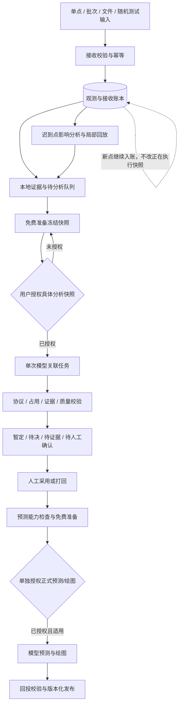

# 增量多目标轨迹关联与预测——技术方案

版本：1.0　日期：2026-11-25　编制：小怪

状态：**目标架构与分阶段实施方案，尚未全部实现**。后续实际改动与验证见[实施进度](实施进度-增量轨迹.md)。本文中的拟新增接口、表、节点和状态，不应当作已有可调用功能。

需求基线：[需求分析](需求分析-增量多目标轨迹关联与预测.md)。本文明确采用“单点/批量/稀疏/乱序/缺阵均可接收”的原则；同步只是一类证据，不是接入门槛。

## 1. 设计决策

| 决策 | 选择与原因 |
|---|---|
| 接入与分析解耦 | 收到点先落账，不等待云模型、双阵补齐或人工确认 |
| 原始事实与关联投影分离 | 测量不因模型改变归属而被改写；不同分析版本可比较 |
| 双时间与冻结快照 | 区分观测发生时间、系统获知时间，防止迟到数据和历史预测穿越 |
| 模型是全局假设选择器 | 本地提供证据与竞争关系；模型不代替编号、几何和占用校验 |
| 能力分级而非统一拒绝 | 单阵可形成方位片段，异步可积累证据；空间结论另行验证 |
| 版本化与显式人工采用 | 新证据可挑战旧假设，但旧预测/确认记录不可被静默覆盖 |
| 费用默认受控 | 到点不自动调用；分析和正式预测分别授权，无自动付费重试 |
| 渐进演进 | 保留现有UI、文件、网关与混合会话，新增v2实时路径，不重写整个项目 |

**不采用**“必须攒够同步双阵再入库”“按文件确定目标”“每批独立分析”“失败自动重问模型”“为提高覆盖率强制归属”。

## 2. 当前架构与改造边界

### 2.1 已有主路径

`frontend/incremental.html` / `mixed-workspace.js`
→ `api/routers/incremental.py`
→ `services/association/mixed_prediction.py`
→ 候选/跨阵证据
→ `ConfiguredModelGateway`
→ 校验及人工确认
→ `model_plot.py`第二次授权
→ JSON结果与浏览器IndexedDB恢复。

当前 `create_mixed` 建立固定点库、别名与会话；`prepare_mixed`允许逐轮选择既有点，并处理未归属、歧义及 `historical_replay`。这不等于已具备任意新点持续追加入口。

### 2.2 可复用与必须改造的部分

| 现有位置 | 复用内容 | 目标改造 |
|---|---|---|
| `frontend/mixed-workspace.js::load` | 格式检查、选点、展示 | 缺阵统计替代缺阵硬过滤；增加追加与替换的明确操作 |
| `frontend/point-sampling.js` | 原点抽样、去重、随机记录 | 保留按点模式，增加可选时刻组/窗口模式，不改变默认接入合法性 |
| `services/inputs/observation_import.py` | ZIP内存读取、路径防护、真值隔离 | 将导入转换为接入批次，保留全部合法点和来源 |
| `mixed_prediction.py` | 增量池、历史重放、占用校验、人工确认 | 改为从冻结快照读取；扩展到真实新增点及片段链 |
| `tracklet_references.py` | 参考候选与弱拟合提示 | 按需滑动覆盖与索引，加入候选诊断，不把参考当答案 |
| `joint_identity.py` / `temporal_geometry.py` | 同步候选、留出证据、运动模型基础 | 保留同步路径；异步路径独立实验，不伪造同步测量 |
| `models/association_wire.py` | 无损表格、行号、理由代码 | 快照内行号契约继续使用；未来增加链/竞争引用，保持版本兼容 |
| `jobs/detached_sse.py` | 页面断开不取消原进程内任务 | 对接持久任务记录与只读事件流；仍不声称跨重启继续原云调用 |
| JSON原子替换、全局LOCK | 旧会话兼容与导出 | v2采用事务账本、每会话提交锁与任务CAS；保留模型资源槽位 |

沿用当前FastAPI、Uvicorn、Pydantic、NumPy、SciPy、Matplotlib、httpx及原生JS。首期新增账本采用Python标准库SQLite，不引入新的云服务或大型分布式依赖。

## 3. 目标架构

以下模块名为**建议新增/拆分位置**，尚未实施。



本地节点可以随接入事件更新诊断；默认没有任何“到点→自动付费”的边。

## 4. 数据模型与时间语义

### 4.1 观测模型（拟新增规范）

```json
{
  "observation_id": "obs-opaque-id",
  "source_id": "source-01",
  "source_observation_id": "raw-id-11",
  "timeline_id": "relative-seconds-01",
  "event_time": 37.0,
  "received_at": "2026-11-25T12:00:00Z",
  "receipt_seq": 123,
  "platform_id": "A",
  "array": "hull",
  "bearing_deg": 104.6,
  "measurement_quality": "unrated",
  "platform_config_version": "cfg-1"
}
```

- `event_time`保留真实测量时间，当前优先兼容相对秒`t`；UTC/其他时钟必须有明确时间基准及转换版本。
- `received_at`由服务器生成，`receipt_seq`用于可靠的到达顺序；不能用文件顺序或观测时间代替接收顺序。
- 不同timeline未经确认不得直接比较；缺少时钟/平台几何配置可入账并标记缺项，不伪造A平台或默认同步。
- `observation_id`全局/会话内稳定，原始编号另存。不要通过重新排序或拼接无限长文件名重编号。
- 可选强度、宽度、误差、质量和原始来源完整保留；未提供误差时不能伪称已标定。
- 接收质量标记与模型归属分开：来源标记不是目标身份或真实置信概率。

### 4.2 状态分层

| 层 | 状态举例 | 说明 |
|---|---|---|
| 接入事实 | accepted / quarantined / conflict / superseded | 无效行隔离，值冲突不覆盖；修订使用新记录及父引用 |
| 观测归属投影 | unprocessed / waiting_evidence / ambiguous / tentative / adopted | 状态属于某分析版本，不改变原始测量 |
| 目标假设 | tentative / supported / review_adopted / dormant / superseded | 人工采用不是物理真值；拆分合并记录谱系 |
| 任务 | prepared / authorized / dispatching / running / awaiting_review / completed / invalid_reply / unknown / stale | 费用和结果生命周期独立于观测接入 |

现有 `call_unknown` 等旧状态保持可读；v2读取层提供明确映射，不能直接批量改写旧JSON。

### 4.3 两个截止边界

因果预测必须同时满足：

```text
receipt_seq <= knowledge_cutoff_seq
event_time <= forecast_origin_time
timeline/config版本可解释且与快照一致
```

已经收到整批前中后段数据，不代表可以拿后段点去评估前段时刻的因果预测。事后轨迹重建允许使用后来信息，但必须使用 `retrospective_reconstruction` 标识，而不是覆盖原预测。

### 4.4 双版本与分析快照

- `observation_revision`：每个新增观测/显式修订批次成功提交后推进；重复接入不推进有效数据版本。
- `state_revision`：关联提案、人工采用、撤回、拆分合并等投影提交时推进。
- `analysis_run_id`：一次分析任务唯一编号。
- 快照记录：选中观测ID及值、历史查询边界、知识截止顺序、事件范围、预测/重建用途、基础state版本、平台/时钟/参数版本、候选图、随机种子和协议/提示模板版本。
- `context_digest`覆盖规范输入及有效配置/模板版本。传输表格是无损表示，不改变授权的观测范围。
- 云运行期间新点只增加账本和待分析队列，不能改变快照内行号，也不能使旧结果的全状态写入覆盖这些新点。
- 配置需记录适用事件时间范围和被系统获知的版本；只作用于未来的新增配置不应使旧快照作废。历史配置追溯修正必须显式建立新解释版本。

## 5. 持久化与事务

### 5.1 v2建议表

| 表 | 关键内容 |
|---|---|
| `live_sessions` | 会话、timeline、当前投影版本、配置版本、模式 |
| `ingest_requests` | 幂等键、载荷摘要、接入结果、批次版本 |
| `observations` | 稳定ID、来源键、event_time、receipt_seq、规范值与接入状态 |
| `observation_events` | 到达、冲突、显式订正、撤回、来源移除等不可变事件 |
| `configuration_versions` | 平台、时钟、误差与算法参数版本，不含认证密钥 |
| `analysis_snapshots` | 冻结输入清单、值摘要、边界、基础版本、协议版本 |
| `analysis_runs` | 授权、预算引用、发送意图、供应商状态、错误与结果位置 |
| `hypothesis_versions` | 片段、链、目标、竞争边和人工决定的版本投影 |
| `prediction_versions` | 预测用途、起点、知识截止、输入引用、输出与不确定性 |
| `run_events` | 可重连SSE事件序号、阶段、公开正文或结果引用 |

首阶段以单进程SQLite事务为准，可采用WAL和明确busy超时。多worker/多实例不直接视为已支持；须另做任务认领、锁和共享存储验收。

### 5.2 接入事务

1. 校验请求结构和资源边界。
2. 查询`session + idempotency_key`；相同摘要返回原结果，不重复写点；同键不同摘要返回409。
3. 对每行进行规范化；合法缺阵点仍accepted。错误行持久隔离并记录原因，默认不吞掉同批合法点。
4. 同来源观测键且内容相同记duplicate；内容不同记conflict，等待显式修订，禁止覆盖。
5. 事务提交有效点、隔离/冲突结果、receipt顺序及接入回执。
6. 本地证据标脏、更新待分析数，不发云请求。

请求JSON整体错误返回422；请求超大等资源错误保留明确失败，不声称已接收。批内部分成功使用200及逐项状态，不靠一个成功布尔掩盖隔离项。

### 5.3 结果提交事务

提交时检查`analysis_run_id + base_state_revision`及配置是否仍适用于快照的输入范围。仅observations继续追加，或配置仅对快照之外的未来生效，不应使旧分析无法保存：旧结果只作用于快照范围，新点仍待分析。

若人工决定或另一分析已改变投影，旧结果标为stale并保留，不最后写入覆盖。后续可免费准备合并复核范围；新云分析须再授权。

SQLite是v2事实与投影的权威存储，JSON作为版本化导出/兼容读模型；不得让两个存储同时不受控地成为可写真相源。

## 6. 逐节点处理方案

所有节点定义均是目标设计。当前原节点将分阶段适配，并保留旧任务的原始执行记录。

| 节点 | 输入 | 输出与规则 | 云调用 |
|---|---|---|---|
| N01 接收与幂等 | 单点/批次/文件 | 接入结果、receipt_seq、隔离/冲突；不等双阵 | 无 |
| N02 时间与配置解释 | 原始t、timeline、配置 | 可比较时间、缺项标记、配置版本；不假同步 | 无 |
| N03 增量影响分析 | 新事件、历史索引 | 待分析范围、受影响片段/目标、局部回放计划 | 无 |
| N04 证据窗口与候选片段 | 当前新点＋必要历史/未决/待证据 | 多尺度片段及不能成段的原因；不要求当前批次点数 | 无 |
| N05 同阵接续与竞争图 | 片段及已有链 | 兼容链、竞争分支、占用约束、断段/折返说明 | 无 |
| N06 跨阵证据与能力判断 | 同步/异步测量、历史链、平台状态 | 证据类型与能力等级；证据不足只降级，不退回接入 | 无 |
| N07 冻结快照与免费准备 | 已解释证据、用户范围 | digest、点数/字符量/缺项、协议和费用提示 | 无 |
| N08 模型全局关联 | 明确授权的冻结快照 | 链/目标假设、待决、待证据分组，不输出自由长篇草稿 | 单次、显式授权 |
| N09 校验与质量审核 | 模型回复、本地证据 | 严格编号、占用、版本、因果与质量检查；低覆盖不强迫填满 | 无 |
| N10 人工采用与投影 | 有效提案、用户决定 | 范围明确的新投影版本、ID谱系及待处理新点 | 无 |
| N11 预测适用性与准备 | 已采用集合、历史、用途与时间边界 | 可发布能力、缺项、预测快照，不把单阵角度当距离 | 无 |
| N12 正式预测/绘图与发布 | 单独授权预测快照 | 模型输出、回投检查、版本发布；失败不线性替代 | 单次、单独授权 |

### 6.1 单点如何利用历史

新点不是单独拿去拟合一条线。N03/N04查询同平台同阵列的相关已有链、历史端点、未归属和待决点，在实际时间差及配置误差条件下生成接续/新生/暂存竞争假设。

每项建议记录`producer`、算法/协议版本及证据引用，明确区分本地候选、模型判断和人工决定，不能把本地候选标成模型已确认。

若历史充分且唯一接续证据明确，一个新点可以更新已有假设。若没有历史，单点依然保存、展示并等待证据；不得硬建一条完整目标轨迹。任何本地判定都保留证据来源，不自动视为人工确认。

### 6.2 片段窗口和竞争图

- 滑动窗口覆盖需要分析的事件范围，不再只凭前、中、后三个固定窗口代表全部数据。
- 可以从8/16个独立时刻、约50%重叠起步做离线调参；这是实验初值，不是输入合法性门槛。
- 按实际时间间隔、测量误差、平台运动和已有模型构造门限。当前5度/秒、15度等值不能未经标定推广为普适物理规则。
- 方位折叠边界和转向保留多分支，不简单把折叠值展开成唯一真实方向。
- 少点二次拟合只有样本内残差，不能自证身份；使用独立时刻数、复杂度、占用竞争及可用留出证据。
- 同阵多个兼容片段组成`stream_group`。物理目标引用同阵集合，避免“一目标最多两个原始片段”误伤断段接续。
- 同阵集合仍须检查同时间竞争、重复使用、接续错误；不是允许任意合并。
- 数值候选预算与排名若启用，必须展示未展开分支和原因；原始点不因此删除或自动认定杂波。

### 6.3 同步与异步分路

**同步路径**：复用真实同时间配对及留出检验。当前实现至少5个真实同步时刻是这条算法路径的条件，不是数据入口条件，也不是要求每个新批次独立满足5个时刻；可使用截止边界内已积累的有效历史。

**异步路径（待实现/验证）**：在各自真实测量时刻使用平台/阵列位置和运动模型约束联合比较，不把不同时间的值改成同一时刻。时间不确定性、模型适用性、可观测性及留出表现达标前，只给候选或证据不足。

若采用插值辅助诊断，必须生成独立`derived_evidence`，记录父观测和方法；不能伪装原始点或仅凭插值升级确认。首期没有经验证的异步空间求解时，明确保留单阵/待决能力，不阻塞数据接收与后续积累。

### 6.4 稀疏与未归属的解释

每个纳入快照的点都要有去向，但并非每点必须被接入轨迹。待证据可分为：缺历史支持、存在竞争、时钟不可比较、几何不足、候选接续不一致、当前范围尚未评估等。

原因按组压缩返回，而非为每点写长篇reason。低覆盖、只覆盖早段、没有跨阵目标等提示质量风险；不得把“存在未归属”自动当错误，也不得把“JSON合法”当识别质量良好。

没有观测到新点不能仅凭页面等待时长断定目标消失。休眠/终止需结合事件时间推进、配置的采样与可见性假设；这些条件未知时状态保留不确定。

## 7. 模型契约与假设层级

### 7.1 输入

沿用无损表格与本轮行号，增加明确版本的：

- `purpose`：关联、因果预测或后验重建；
- `knowledge_cutoff_seq`、`forecast_origin_time`、`event_range`；
- `existing_stream_groups`、`continuation_edges`、`conflict_sets`；
- `observability`及具体缺项；
- 新/历史/未归属/待决观测的角色，不传来源目标标签或真值。

输入账本保留全部合法点；某次分析因资源或用户目的只选部分范围时，必须免费预览并由用户确认。不能在网关里静默裁掉观测、偷换范围或自动拆收费轮次。

### 7.2 输出（拟扩展v2契约）

```json
{
  "format": "association-compact-v2",
  "snapshot_id": "snapshot-01",
  "base_state_revision": 4,
  "stream_groups": [
    {"group_ref":"G1","fragment_refs":["R001","R004"],"reason_code":"continuity"}
  ],
  "target_hypotheses": [
    {"target_ref":"H1","stream_group_refs":["G1"],"reason_code":"tentative"}
  ],
  "unresolved_groups": [
    {"point_indices":[3,8],"reason_code":"insufficient"}
  ]
}
```

该示例不是当前已支持API。精确字段、引用命名空间及完整schema在M2落地时冻结版本；至少保证以下语义：

- 模型仅选择/提出假设，不更改测量值、平台参数、时间或稳定ID。
- 原片段可在候选阶段参与竞争；采用后唯一占用约束由程序核对。
- 多片段集合的兼容性必须验证，不能只因代码短就认定同目标。
- 临时引用只在本快照有效。物理目标稳定ID由程序分配，拆分/合并有父子谱系，不重用已退役ID。
- 不得把“review_adopted”写成“真实身份已确定”。
- 供应商没有原生约束解码能力时，协议提示与本地严格校验仍需并存，不能声称绝对阻止格式错误。

## 8. 迟到补点、修订与预测边界

### 8.1 影响范围

从迟到点的event_time及相关流开始查询必要历史窗口，并沿接续/竞争/目标依赖图扩大范围。不能只固定“从该秒往后”而漏掉早先身份关系；必要时允许扩大到整个相关连通分量。

回放计划展示受影响的观测、片段、目标、确认和预测版本。局部不等于永不全局；扩大范围或新增云分析仍须明示并授权，不能悄悄追加调用。

### 8.2 预测版本

预测至少记录：`prediction_id`、`snapshot_id`、`issued_at`、`knowledge_cutoff_seq`、`forecast_origin_time`、预测区间、能力级别、配置版本、父预测版本及修订原因。

后来补到旧点时：保留原预测；生成新的当前估计或明确的后验重建。界面分开显示实际观测、候选拟合/重建、未来预测及不确定性，不将补算点画成真实观测。

当前项目停用的“本地线性代画”不自动恢复。若未来增加本地诊断外推，必须另设明确算法标签和启用项，不能替代原先授权的模型预测结果。

## 9. 接口方案

### 9.1 现有接口保持兼容

继续保留 `/api/incremental/mixed-sessions` 的创建、preview、step、review、plot-preview、plot-step、execution、catalog、prepare-rerun及恢复入口。当前step支持POST流式返回；现有接口不因此自动获得新点接入能力。

### 9.2 v2拟新增接口

| 方法与路径 | 作用 | 费用 |
|---|---|---|
| `POST /api/incremental/live-sessions` | 创建可为空的实时会话，指定timeline与配置引用 | 无 |
| `POST /api/incremental/live-sessions/{sid}/observations` | 单点/批次接入，返回accepted/duplicate/quarantined/conflict | 无 |
| `GET /api/incremental/live-sessions/{sid}` | 状态、版本、能力、待分析数与任务摘要 | 无 |
| `GET /api/incremental/live-sessions/{sid}/observations?after_seq=...` | 增量读取接收事实 | 无 |
| `POST /api/incremental/live-sessions/{sid}/prepare` | 冻结分析范围、迟到影响范围与上下文摘要 | 无 |
| `POST /api/incremental/live-sessions/{sid}/analyses` | 对明确快照授权并创建单次模型任务 | 显式授权 |
| `GET /api/incremental/live-sessions/{sid}/analyses/{rid}/events` | 按事件序号只读重连SSE，不重开模型任务 | 无 |
| `POST /api/incremental/live-sessions/{sid}/analyses/{rid}/review` | 采用/打回提案，检查基础投影版本 | 无 |
| `POST /api/incremental/live-sessions/{sid}/predictions/prepare` | 冻结预测用途、时空能力及截止边界 | 无 |
| `POST /api/incremental/live-sessions/{sid}/predictions` | 独立授权正式预测/绘图 | 显式授权 |

所有这些接口均为提案。旧文件导入后可批量接入v2账本；旧会话只有用户明确升级时才迁移，不自动覆盖原JSON。

### 9.3 接入请求示例

```json
{
  "idempotency_key":"ingest-request-01",
  "source_id":"sensor-A",
  "timeline_id":"relative-seconds-01",
  "observations":[
    {"source_observation_id":"raw-11","event_time":37.0,"platform_id":"A","array":"hull","bearing_deg":104.6}
  ]
}
```

单点就是长度为1的数组。另一阵未到不是422原因。返回每项稳定ID、接收状态、原因、receipt序号与最新observation_revision。

### 9.4 分析授权示例

```json
{
  "idempotency_key":"analysis-request-01",
  "snapshot_id":"snapshot-01",
  "expected_state_revision":4,
  "context_digest":"0000000000000000000000000000000000000000000000000000000000000000",
  "consent":true
}
```

示例中的摘要全零仅为格式占位，不是真实准备签名。缺授权、摘要不符或投影过期时不发模型请求。重复授权返回原任务，不产生第二次发送。未知调用的再次请求必须走显式手动重跑流程，保留`rerun_of`和重复费用风险确认，不能换个请求键就绕过保护。

## 10. 任务、流式和费用安全

### 10.1 调用状态机

```text
prepared → authorized → dispatching → running
                                 ├→ valid_proposal → awaiting_review
                                 ├→ invalid_reply
                                 ├→ output_truncated / failed
                                 └→ unknown
```

- 发送意图和任务认领在网络请求前持久化，预算与授权绑定具体快照、用途和模型配置引用。
- 发送窗口崩溃无法证明上游是否接收时，保守标记unknown，不自动重新发。
- 本地只能保证同一自动任务不主动重复发送；无供应商幂等支持时不能承诺外部严格exactly-once或绝对不重复计费。
- 到点、页面刷新、SSE重连、查看原文和本地校验均不是调用触发器。
- 首期不默认部署自动云分析定时器。若未来需要自动策略，必须另有可撤回、范围/次数/有效期明确的授权需求。

### 10.2 进程生命周期

现有detached SSE继续复用，但后台任务不跨进程重启存活。启动时扫描未终结任务：已进入发送窗口的标记unknown并等待核对；尚未发送的任务先要求用户恢复确认，不因启动自动扣费。

只读事件流用事件序号重连，心跳不是模型正文。完整正文以实际收到的内容为准；截断/校验失败分类明确，不因流结束就声明分析成功。

### 10.3 并发

接入事务、分析投影提交锁、模型资源槽位分开。正在运行云任务不能持有阻塞所有新点接入的全局业务锁。相同会话的投影写入用CAS/事务串行；不同会话可按资源预算并行；客户端重复请求复用同一任务。

## 11. 前端交互

1. 显示“替换当前数据”和“追加到当前会话”，防止文件导入无意重置历史。
2. 原始接收量、有效量、隔离量、未分析量、快照范围分别展示。
3. 缺阵统计为诊断面板；不在默认load中排除缺阵点。
4. 采样模式可选：按点随机、按完整时刻组、按窗口/手动范围；实时接入本身不抽样丢点。
5. 按点填写的是单独观测数；按组填写的是时刻组数；显示真实hull/tow计数、同步支持与是否保留来源外已选点。
6. 在“100点、无同步”的情况下，解释当前可做什么，而非一律阻止关联。
7. 分析中/等待确认时，新点继续显示为“新增待分析”，不混入旧任务正文或旧确认范围。
8. 目标/片段面板展示时间范围、实际支持点、竞争关系、未归属原因与来源版本，而非仅展示JSON。
9. 低覆盖、仅早段接入、空间证据不足给出告警，但不把未决率当唯一错误指标。
10. 旧预测、当前估计、后验修订和未来预测使用不同标签/图层，真实观测与生成点不可混画。

## 12. 模块落地建议

| 拟新增/调整位置 | 职责 |
|---|---|
| `repositories/live_observation_repository.py` | SQLite接入账本、幂等、配置版本、快照事务 |
| `services/inputs/live_observation_input.py` | 单点/批次规范化、时间基准和来源映射 |
| `services/association/incremental_evidence.py` | 索引、受影响范围、窗口与历史证据查询 |
| `services/association/continuation_graph.py` | 片段链、竞争边、稳定假设ID及谱系 |
| `services/association/observability.py` | 能力等级、同步/异步路径与降级原因 |
| `services/association/replay_plan.py` | 迟到事件的依赖扩展、局部回放和旧预测保护 |
| `services/jobs/live_analysis_jobs.py` | 持久任务状态、认领、费用幂等和只读事件流 |
| `api/routers/live_tracking.py` | v2接口，保持HTTP层薄，不把算法和DB事务塞入路由 |
| 现有mixed-workspace相关前端 | 新增入口和视图，逐步拆出接入/任务/图层模块，不改用新框架 |

这些名称是建议，不表示这些文件已存在；实施时按仓库实际约定调整。

## 13. 测试与指标

### 13.1 分层验证

- 单元：时间基准、缺阵接收、稳定ID、重复/冲突、快照不可变、行号边界、占用、谱系和回放影响。
- 属性/排列：同一测量集多种到达顺序、批次大小、采样种子；比较最终账本一致性及同一快照本地证据复现。
- 故障注入：接入写入失败、云发送前/中/后崩溃、页面断连、输出耗尽、格式错误、人工确认与新点同时发生。
- 假网关：固定候选选择与错误返回，确认授权和调用计数；不依赖真实密钥，不网络重试。
- 前端：单点入库、追加不清空、采样单位、阶段状态、版本对比、流重连与旧后端拦截。
- 数值场景：交叉、断段、折返、阵列延迟、缺阵、平台运动、时间偏移与错误几何；同步和异步分开评价。
- 真实模型盲评：仅用户明确授权后，小规模固定数据/种子/费用上限；报告波动，不用一次成功宣称准确率提升。

### 13.2 指标与防作弊

工程硬指标按需求第9节：有效数据不丢、无确定重复占用、快照与旧预测不被覆盖、相同请求无自动重复发送。

质量指标同时包括误合并、误拆分、身份切换、错误/正确接续、待决比例、时间覆盖、方位/空间误差及可分析样本范围。不能强行分配所有点来优化覆盖；不能把镜像分支数、阵列数、文件数当目标数。

有标签时使用隔离评估器对齐目标ID，不能以程序生成ID字符串是否一致判正确。时间相邻样本和同一生成场景按场景分组评估，防止训练/调参/验收泄漏；在线回放必须使用当时知识截止。真值与来源标签不得进入模型关联输入。

阈值、窗口、误差代理及模型版本随实验记录。目标SLA和准确率门槛待明确硬件、流量与标定数据后冻结，本文件不编造已有性能结果。

## 14. 需求追踪矩阵

| 需求 | 主要设计位置 | 关键验收 |
|---|---|---|
| FR-01 | 接入事务、N01、v2接入API | AT-01/02/03 |
| FR-02 | 幂等键、来源键、冲突事件 | AT-07/08 |
| FR-03 | event_time/received_at/receipt_seq、timeline | AT-04/05/10 |
| FR-04 | 可选采样模式、明确单位、原始账本 | AT-12 |
| FR-05 | N03～N05与历史池 | AT-02/03/09 |
| FR-06 | stream_group、假设版本、ID谱系 | AT-07/11 |
| FR-07 | N06同步/异步分路与能力审核 | AT-05/06 |
| FR-08 | 双截止、预测版本、N11/N12 | AT-13/17 |
| FR-09 | replay_plan、依赖图、旧预测保护 | AT-04/11/17 |
| FR-10 | N10、CAS、人工作用范围 | AT-09/10 |
| FR-11 | 发送意图、幂等任务、独立授权 | AT-08/14/15 |
| FR-12 | 持久事件、只读SSE、结果读取 | AT-14/15 |
| FR-13 | 去向口径、质量告警、原因分组 | AT-07/13 |
| FR-14 | 账本/投影分离、事务与锁 | AT-08/09 |
| FR-15 | 盲关联与独立评估 | AT-16/17 |
| FR-16 | 配置与timeline版本、缺项不拒收 | AT-05/10 |
| FR-17 | 原始与结果导出、显式迁移/删除 | AT-18 |
| FR-18 | 显式上下文范围和资源反馈 | AT-12/18 |

## 15. 实施、迁移与回退

### M0：先纠正输入口径

解除默认导入的双阵硬过滤，改成保留＋诊断；单点/缺阵前端用例补齐；采样UI明确模式与单位，按点随机依然可用。不要同时重写模型算法，先证明合法输入不丢。

### M1：持久增量入口

增加SQLite账本、稳定ID、幂等、双时间、配置版本、空会话及真正追加接口。验证云执行/人工确认期间接入不阻塞。此阶段可只生成本地待分析状态，不需要真实模型。

### M2：增量证据与假设

扩展滑动候选、同阵集合、竞争图、迟到影响计划和协议v2。同步路径先回归，异步路径单独标实验状态；不要在这一阶段宣称单点天然可定位。

### M3：任务与预测

冻结快照、持久任务、只读流重连、双截止与独立预测授权；测试崩溃未知和重复费用防护。旧会话仍走旧引擎，v2通过明确版本选择。

### M4：评估及按需迁移

用固定盲评集验证，多种到达顺序及批次回放；用户授权后有限真实模型比较。旧JSON复制迁移为v2账本，保留原文件、别名和历史结果，记录迁移映射，不直接原地改写。

回退以停用v2入口和恢复旧只读/已验证路径为主；不能把新采集数据删掉或硬回滚用户工作。每阶段先备份、再迁移副本、完成读取与数量校验；生产库或不可恢复删除需单独确认。

## 16. 风险与保留事项

| 风险 | 控制 |
|---|---|
| 方位信息本身多解 | 输出候选与缺项，不用模型“自信”覆盖可观测性限制 |
| 异步时钟未知 | 保留原始时间与timeline，等待配置或明确的对齐版本，不伪同步 |
| 模型仍可能长篇/错引用 | 紧凑协议、严格校验、原文保留；原生约束解码需按供应商支持另测 |
| 稀疏抽样漏掉机动 | 保留实验模式和完整原始数据；用多种采样/到达回放评估，不一律强制补成同步 |
| 大数据计算/上下文压力 | 本地索引与队列、显式范围预览；不静默裁剪、不自动拆收费调用 |
| 并发旧快照覆盖新事实 | SQLite事务、独立版本、冻结输入、CAS、stale结果留档 |
| 本地/局域网数据访问 | 现有同源/TrustedHost不是用户认证；多人或开放网络部署需额外认证与传输保护 |
| 文件与数据库隐私 | 默认本地存储不等于加密；OS权限、导出、保留和物理删除政策需落实，不记录密钥 |
| 程序停止后的外部调用结果 | unknown保守处理，核对供应商记录，不自动重发 |

## 17. 本次文档核对范围

核对了现有导入/选点、`create_mixed`/`prepare_mixed`/`review_mixed`、同步证据、紧凑协议、流式任务、原子JSON保存、资源边界和依赖。没有实施本文新增接口/存储/算法，没有重新请求真实模型，也没有验证本文所列全部新验收用例。

历史文档中的“强制双阵筛选”和“仅同步组输入”不再作为目标架构要求。当前代码尚未完成该项迁移，应以需求基线逐阶段改造并提交新的实测结果。
